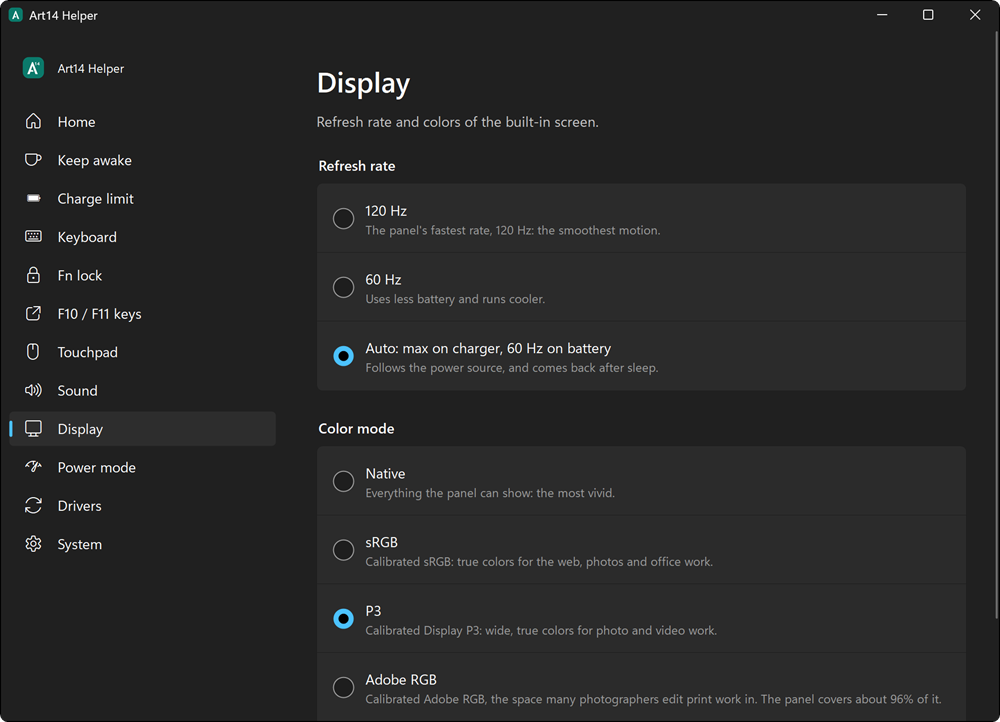
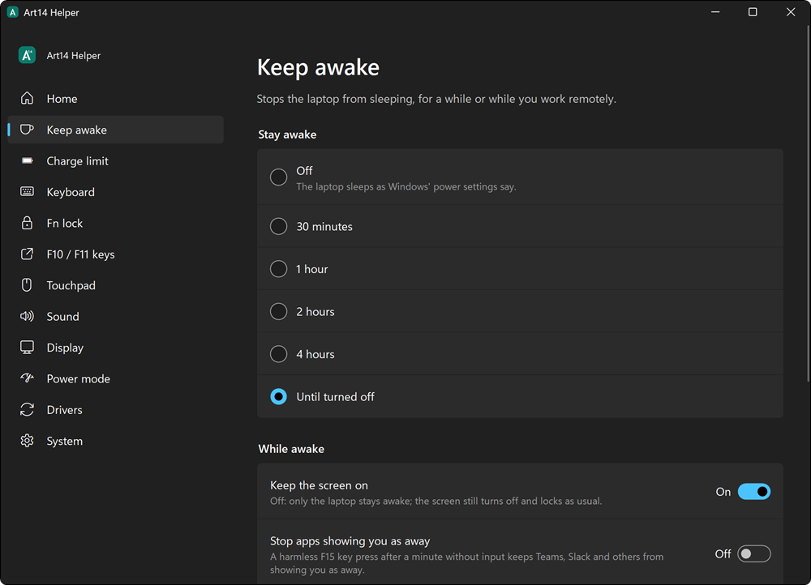
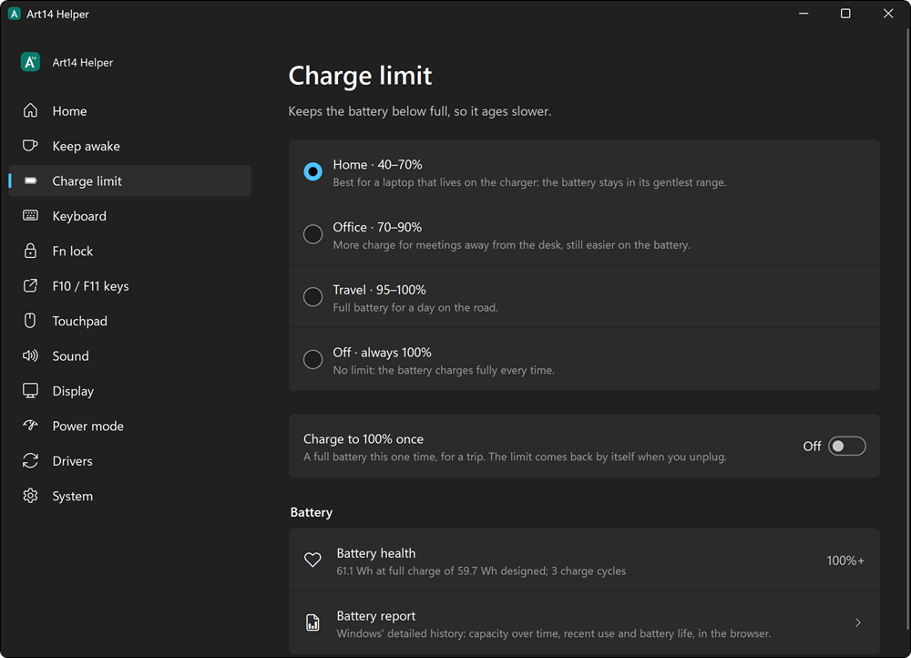
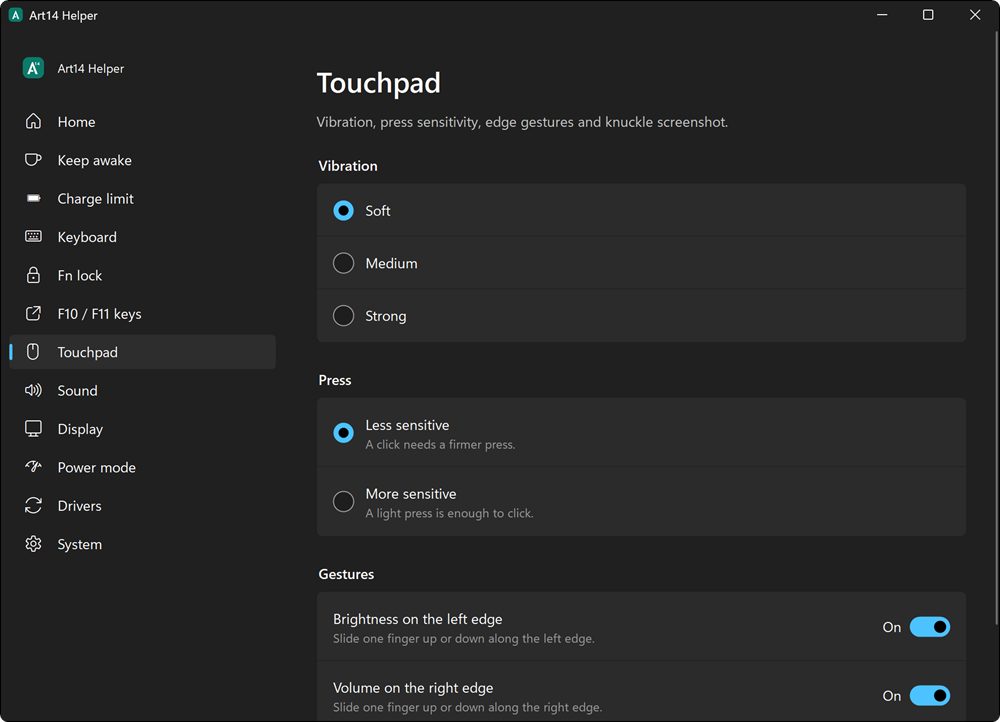
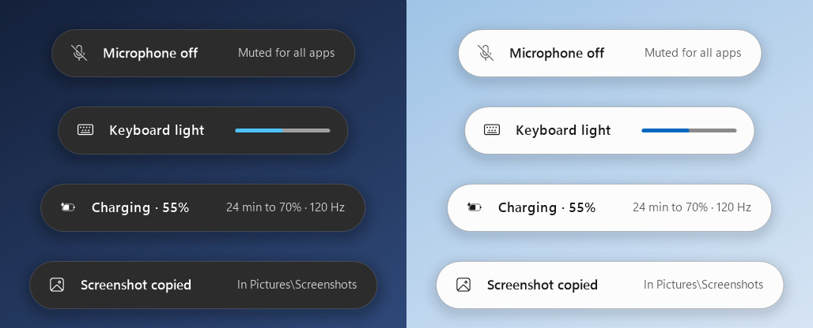

<div align="center">


# Art14 Helper

**The HONOR PC Manager features that matter on the MagicBook Art 14, in one tiny exe.<br>
No services. No telemetry. No ads. Zero CPU while idle.**

[](LICENSE)


[**Download the latest release**](../../releases/latest)
&nbsp;&nbsp;·&nbsp;&nbsp;[Features](#features)
&nbsp;&nbsp;·&nbsp;&nbsp;[Screenshots](#screenshots)
&nbsp;&nbsp;·&nbsp;&nbsp;[Install](#install-update-uninstall)
&nbsp;&nbsp;·&nbsp;&nbsp;[FAQ](#faq)

<br>


</div>

> [!NOTE]
> **Unofficial.** Not made, endorsed or supported by HONOR. HONOR and MagicBook are
> trademarks of their owner, used here only to say which laptop this works with. Use at
> your own risk.

## Why

HONOR PC Manager wraps a handful of useful switches in a heavy bundle of services,
background processes and ads. **Art14 Helper keeps the switches and drops the rest.** It
talks to the laptop's BIOS, touchpad and graphics driver directly, waits for Windows to
tell it when something happens instead of polling, and sits in Windows 11's efficiency
mode while no window is open. It was inspired by open-source projects on GitHub that
showed these laptops can be controlled without HONOR's software.

| | HONOR PC Manager | **Art14 Helper** |
|---|:---:|:---:|
| What you install | a suite of apps and services | **one 12 MB exe** |
| Background services | several | **none** |
| Ads and promotions | yes | **never** |
| Open source | no | **yes, GPL v3** |

Art14 Helper itself sends no telemetry, needs no account, uses about **11 MB** of memory and
**no CPU** while idle.

## Features

<table>
<tr>
<td width="50%" valign="top">

### Battery
- **Charge limit:** Home 40–70 %, Office 70–90 %, Travel 95–100 %, or off.
- **Charge to 100 % once** for a trip: the limit comes back by itself when you unplug.
- **Battery health** against the design capacity, cycle count, and Windows' battery report.

</td>
<td width="50%" valign="top">

### Display
- **Refresh rate** 120 Hz, 60 Hz, or **Auto** (fastest on the charger, 60 Hz on battery).
- **Calibrated color modes:** sRGB, Display P3, Adobe RGB or native, built from the panel's
  own factory measurement and loaded into the Intel graphics driver, with matching color
  profiles for color-managed apps. Native or D65 white.
- Touchscreen on or off.

</td>
</tr>
<tr>
<td valign="top">

### Keyboard and keys
- **Keyboard light** Off, Dim, Bright or **Auto**: follows the room through the light sensor,
  smoothly and at no extra battery cost. Plus the idle timeout.
- **Fn lock:** standard F-keys or media keys.
- **F7** mutes the mic for every app and lights the key. **F8** is a camera privacy switch
  that works even mid-call. **F12** opens the screen snip.
- **F10 / F11** open an app of your choice.

</td>
<td valign="top">

### Touchpad
- Vibration strength and press sensitivity.
- **Slide** along the left edge for brightness, the right edge for volume.
- **Knock twice with a knuckle** for a screenshot, saved to `Pictures\Screenshots` and
  copied to the clipboard.

</td>
</tr>
<tr>
<td valign="top">

### Power and keep awake
- Windows' **power mode** (efficiency, balanced, performance) one click away.
- **Keep awake** for 30 min to 4 h or until turned off, like Caffeine, with optional "keep
  the screen on" and "stop apps showing you as away". Survives app updates and restarts,
  and ends on time even if the laptop slept in between.
- **Remote mode** for work that runs while you're away: stays awake, turns the screen off
  and keeps running with the lid closed. Separate switches for the lid.

</td>
<td valign="top">

### Maintenance and sound
- **BIOS and driver updates** from HONOR's own catalog, with every download checked.
- **Driver backup and restore**, for a clean Windows reinstall.
- **Settings backup and restore**, and one-click diagnostics for a bug report.
- **Spatial or stereo** speaker processing.

</td>
</tr>
</table>

## Screenshots

**Left-click** the tray icon for the settings window: Windows 11 style, light or dark like
Windows, with a Home page (battery, charge limit, temperatures, fans, battery health,
quick settings) and one page per feature. It works with the mouse or the keyboard, and
options that don't apply right now are grayed out with the reason. **Right-click** for the
same choices as a quick menu; **hover** for temperatures, fans and battery power.

<table>
<tr>
<td width="50%"></td>
<td width="50%"></td>
</tr>
<tr>
<td align="center"><sub><b>Display</b>: refresh rate and calibrated color modes</sub></td>
<td align="center"><sub><b>Keep awake</b>: timers, remote mode and the lid</sub></td>
</tr>
<tr>
<td></td>
<td></td>
</tr>
<tr>
<td align="center"><sub><b>Charge limit</b>: limits, a one-time full charge, battery health</sub></td>
<td align="center"><sub><b>Touchpad</b>: vibration, gestures, knuckle screenshot</sub></td>
</tr>
</table>

### Popups that know when to stay quiet

<div align="center">

</div>

They look and move like Windows 11's own volume flyout, and appear **only** for what you
didn't just do yourself and can't see otherwise:

- **a key or gesture:** F7, F8, Fn+Space (with a level bar), the touchpad key, the knuckle screenshot;
- **something that changed by itself:** the charger plugged in (charge level, time to the
  limit or why it isn't charging), Auto switching the refresh rate, keep awake running out;
- **a choice that didn't apply**, with the reason (for example "Turn off HDR first");
- **a result you can't see:** diagnostics copied, settings restored.

Choices you make in the menu or the settings window show no popup: you can see them there.

## Install, update, uninstall

**Requirements:** HONOR MagicBook Art 14 (2024) with Intel Core Ultra and Windows 11. Other
HONOR laptops may work in parts; the app only offers what it finds. Administrator rights
once, to install; after that it starts at sign-in without prompts.

| | |
|---|---|
| **Install** | Run `Art14Helper.exe`. The setup window offers **Start with Windows** and **Apply recommended settings**, then installs to `C:\Program Files\Art14Helper` after one UAC prompt, with a Start menu entry and an entry in Settings > Apps. |
| **Update** | Run the new exe and click **Update**. The running copy closes cleanly, is replaced and starts again; your settings stay. |
| **Uninstall** | Settings > Apps > Installed apps > Art14 Helper, or System > Uninstall in the app. Removes the program, its autostart task, Start menu entry and log, puts the screen back to native colors with HONOR's own profile, and undoes the lid settings the app changed. You can keep your settings for a reinstall, and turn the charge limit off; other BIOS settings stay as they are. |

The app needs admin rights for the BIOS, so it lives in Program Files, where only
administrators can write: no other program can swap the exe that Windows starts elevated.

<details>
<summary><b>What "Apply recommended settings" sets</b></summary>

<br>

On the first start: charge limit Home, keyboard light Auto with a 30 s timeout, standard
F-keys, F10/F11 nothing, touchpad soft vibration and less sensitive press, both edge
gestures and the knuckle screenshot on, spatial sound, refresh rate Auto, Display P3 with
native white, and start with Windows. Keep awake and its options are off. After that, your
choices are kept.

With it off, the app changes nothing until you choose something.

</details>

### Why the exe isn't signed

Windows will call it an "unknown publisher", in SmartScreen and in the UAC prompt. That's
because the exe has no code-signing certificate, and it never will. Certificates cost money
every year, paid to a certificate company, and this free, open-source project will never
spend money on one. A signature only says who built a file; it says nothing about what the
file does.

**The source is the guarantee here.** If you don't want to trust a downloaded exe, don't:
read the code and [build it yourself](#build). It takes one command, and that's what open
source is for.

## Privacy and safety

- **No telemetry, no accounts, no ads, no self-updater.**
- The only network use is the Drivers page asking HONOR's update server for new versions:
  laptop model, BIOS and driver versions, Windows version and display language. No serial
  number, no personal data.
- Downloads are checked by HTTPS, SHA-256 and the digital signature of every program file.
- Settings stay in `HKCU\Software\Art14Helper`, the log in `C:\Program Files\Art14Helper\Logs`.
- The app ships no HONOR files; its icons come from the Windows icon font.

## FAQ

<details>
<summary><b>The screen blinks when I plug in or unplug.</b></summary>
<br>
With the refresh rate on Auto, the app switches between 120 and 60 Hz. This panel can only
do that with a full display mode change, which blanks the screen for a moment (its graphics
driver has no seamless low refresh rate). The popup tells you when it happened. Pick a fixed
rate to avoid it.
</details>

<details>
<summary><b>Tapping Fn changes the keys, but the app shows the old setting.</b></summary>
<br>
The firmware switches the Fn lock on a tap without telling Windows, so no app can follow
it. Choosing in the app is always exact.
</details>

<details>
<summary><b>I see two popups for one key.</b></summary>
<br>
HONOR's own popup service is still running. Disable it:
<code>Set-Service OSDServer -StartupType Disabled</code>
</details>

<details>
<summary><b>Color modes do nothing.</b></summary>
<br>
They need HDR off. The chosen mode comes back by itself when HDR is turned off.
</details>

<details>
<summary><b>Battery health shows 100%+.</b></summary>
<br>
A new battery usually holds a little more than its rating. The exact numbers are in the
tooltip and on the Charge limit page.
</details>

<details>
<summary><b>Windows asks for my password when the screen comes back in Remote mode.</b></summary>
<br>
That's Windows' sign-in setting (Settings > Accounts > Sign-in options); everything kept
running meanwhile.
</details>

<details>
<summary><b>Something doesn't work.</b></summary>
<br>
System > Copy diagnostics, and paste it into your report. It contains versions, what the
app found and the last log lines, never the serial number.
</details>

## Build

Needs Windows and the .NET 10 SDK. For the native exe also the Visual Studio C++ build tools
("Desktop development with C++"); without them the script builds a trimmed single file,
which works the same.

```powershell
powershell -ExecutionPolicy Bypass -File .\build.ps1 -SelfTest
```

The result is `dist\Art14Helper.exe`. `-SelfTest` runs the exe's `--self-test` (WMI,
devices, drawing, a window opened and closed; no setting is touched). Tests cover the logic
that needs no hardware:

```powershell
dotnet test --project tests\Art14Helper.Tests\Art14Helper.Tests.csproj
```

## Documentation

| | |
|---|---|
| [Architecture](docs/ARCHITECTURE.md) | How the code is organized: threads, UI, startup |
| [Hardware reference](docs/HARDWARE.md) | Every BIOS command, event, touchpad report and registry key the app uses |
| [Hardware test](docs/HARDWARE_TEST.md) | The checklist for testing on the laptop |
| [Changelog](CHANGELOG.md) | What changed in each version |
| [Contributing](CONTRIBUTING.md) · [Code of conduct](CODE_OF_CONDUCT.md) | How to help |
| [Security policy](SECURITY.md) · [Getting help](SUPPORT.md) | Reporting problems |
| [Third-party notices](THIRD-PARTY-NOTICES.md) | What the app builds on |

## License

Copyright © 2026 The Art14 Helper authors.

Art14 Helper is free software: you can redistribute it and/or modify it under the terms of
the [GNU General Public License version 3](LICENSE), as published by the Free Software
Foundation. In short: you may use, study, change and share it, and any version you share
must stay free under the same license, with its source. It comes with no warranty.
