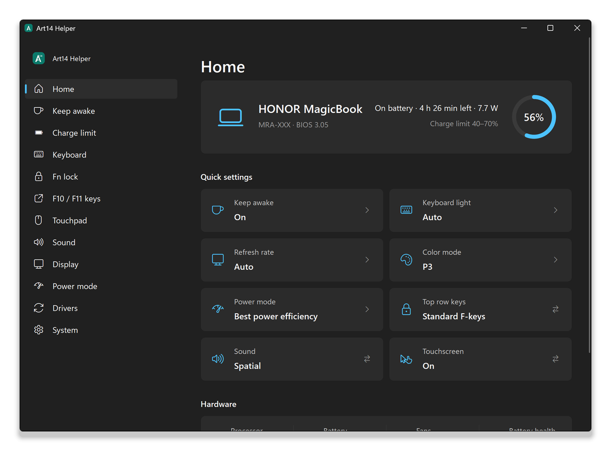

<div align="center">


# Art14 Helper

**A small, fast replacement for HONOR PC Manager on the HONOR MagicBook Art 14.**<br>
One 10 MB exe. No services, no telemetry, no ads, no CPU while idle.

[](LICENSE)


**[Download the latest release](../../releases/latest)**



</div>

> [!NOTE]
> Unofficial. Not made, endorsed or supported by HONOR. HONOR and MagicBook are trademarks
> of their owner, used here only to say which laptop this works with. Use at your own risk.

## Why

HONOR PC Manager wraps a handful of useful switches in a suite of apps, background services
and ads. Art14 Helper keeps the switches and drops the rest. It talks to the laptop's BIOS,
touchpad and graphics driver directly, waits for Windows to report changes instead of
polling, and runs in Windows 11's efficiency mode while no window is open: about 11 MB of
memory and no CPU at rest.

## Features

**Battery**
- Charge limit: Home 40–70 %, Office 70–90 %, Travel 95–100 %, or off.
- Charge to 100 % once, for a trip: the limit comes back by itself when you unplug.
- Battery health against the design capacity, cycle count, and Windows' battery report.

**Keyboard and keys**
- Backlight Off, Dim, Bright or Auto, following the room through the light sensor, plus
  the idle timeout.
- Fn lock: standard F-keys or media keys.
- F7 mutes the microphone for every app and lights its LED; F8 is a camera privacy switch
  that works even during a call; F10 and F11 open an app of your choice.

**Touchpad**
- Vibration strength and press sensitivity.
- Slide along the left edge for brightness, the right edge for volume.
- Knock twice with a knuckle for a screenshot, saved and copied to the clipboard.

**Display**
- Refresh rate 120 Hz, 60 Hz, or Auto: fastest on the charger, 60 Hz on battery.
- Calibrated sRGB, Display P3 and Adobe RGB, built from the panel's own factory measurement
  and loaded into the Intel graphics driver, with matching color profiles.

**Power**
- Windows' power mode one click away.
- Keep awake for 30 minutes to 4 hours or until turned off, optionally keeping the screen
  on and apps from showing you as away. It survives restarts and ends on time after sleep.
- Remote mode for work that runs while you're away: awake, screen off, and running with
  the lid closed.

**Maintenance**
- BIOS and driver updates from HONOR's catalog, with every download checked.
- Driver backup and restore for a clean Windows reinstall, settings backup, and one-click
  diagnostics for bug reports.

## Popups

<div align="center">

</div>

Popups look and move like Windows 11's own volume flyout. They appear only when you need
them: for a key or gesture (F7, F8, Fn+Space, the touchpad key, the knuckle screenshot),
for something that changed by itself (the charger plugged in, the camera taken off or put back, Auto switching the refresh
rate, keep awake running out), or when a choice couldn't be applied. A choice you just made
in the menu or the settings window shows no popup: you can already see it.

## Install

Requires the HONOR MagicBook Art 14 (2024) with Intel Core Ultra and Windows 11.

1. [Download](../../releases/latest) `Art14Helper.exe` and run it.
2. Keep **Start with Windows** and **Apply recommended settings** on, click **Install** and
   accept the UAC prompt.

It installs to `C:\Program Files\Art14Helper`, where only administrators can write, and
starts at sign-in without prompts. To update, run a newer exe and click **Update**; your
settings stay. To uninstall, use Settings > Apps: it also puts the display colors and lid
settings back. What the recommended settings are is in the [user guide](docs/GUIDE.md).

**The exe isn't code-signed, on purpose.** Windows will call it an "unknown publisher".
Certificates cost money every year, and this free, open-source project will never pay for
one; a signature only says who built a file, not what it does. If you'd rather not trust a
download, read the code and [build it yourself](#build).

## Privacy

- No telemetry, no accounts, no ads, no self-updater.
- The only network use is the Drivers page asking HONOR's update server for new versions:
  laptop model, BIOS and driver versions, Windows version and language. Never a serial
  number or anything personal.
- Downloads are checked by HTTPS, SHA-256 and the digital signature of every program file.
- The app ships no HONOR files.

## Build

Needs Windows and the .NET 10 SDK. The Visual Studio C++ build tools ("Desktop development
with C++") give the native exe; without them you get a trimmed single file that works the
same.

```powershell
powershell -ExecutionPolicy Bypass -File .\build.ps1 -SelfTest
dotnet test --project tests\Art14Helper.Tests\Art14Helper.Tests.csproj
```

The exe lands in `dist\`. `-SelfTest` runs its built-in check (WMI, devices, drawing, a
window opened and closed) without touching any setting.

## Documentation

| | |
|---|---|
| [User guide](docs/GUIDE.md) | Popups, setup, recommended settings, privacy details, FAQ |
| [Architecture](docs/ARCHITECTURE.md) | How the code is organized: threads, UI, startup |
| [Hardware reference](docs/HARDWARE.md) | Every BIOS command, event and register the app uses |
| [Hardware test](docs/HARDWARE_TEST.md) | The checklist for testing on the laptop |
| [Changelog](CHANGELOG.md) | What changed in each version |
| [Accessibility](ACCESSIBILITY.md) | Keyboard, screen readers, motion: what works, known gaps, workarounds |
| [Contributing](CONTRIBUTING.md) · [Security](SECURITY.md) · [Support](SUPPORT.md) | Helping, reporting, getting help |

## License

Copyright © 2026 The Art14 Helper authors. Free software under the
[GNU General Public License v3](LICENSE): use, study, change and share it; any version you
share stays free, with its source. No warranty.
