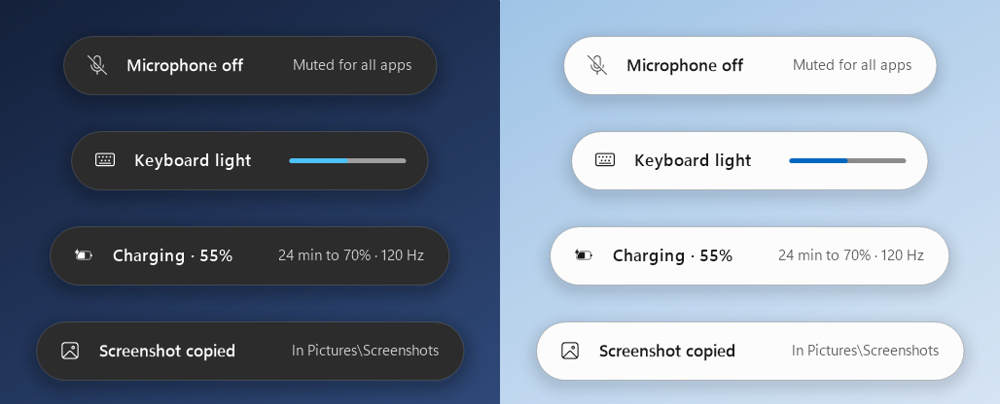

# User guide

How Art14 Helper behaves, what it sets up, and answers to common questions. For a quick
overview see the [README](../README.md).

## The app

**Left-click** the tray icon for the settings window. It follows Windows' light or dark
mode and has a Home page (battery, charge limit, temperatures, fans, battery health, quick
settings) plus one page per feature. It works with the mouse or the keyboard (Tab, Enter,
Space, Esc). Options that don't apply right now are grayed out with the reason.

**Right-click** the icon for the same choices as a quick menu. **Hover** over it for
temperatures, fan speeds and battery power.

**Language:** the app speaks English, Russian and Simplified Chinese. It follows Windows'
display language; System > Language picks one yourself, and the change applies at once. The
log and Copy diagnostics stay in English, so bug reports can be read by anyone.

**Limited mode:** the app needs admin rights for the BIOS. If it ever runs without them (for
example after a failed update), it says so with a popup and a first line in the tooltip,
and **Restart with admin rights** at the top of the tray menu fixes it in one click.

## Popups

Popups look and move like Windows 11's own volume flyout, and appear only for what you
didn't just do yourself and can't see otherwise:

- a key or gesture: F7, F8, Fn+Space (with a level bar), the touchpad key, the knuckle
  screenshot;
- something that changed by itself: the charger plugged in (charge level, time to the
  limit or why it isn't charging), Auto switching the refresh rate, keep awake running out,
  the magnetic camera taken off or put back (with a reminder when F8 privacy is on), limited
  mode, and a new version when the update notice is on;
- a choice that didn't apply, with the reason (for example "Turn off HDR first");
- a result you can't see: diagnostics copied, settings restored.

Choices you make in the menu or the settings window show no popup: you can see them there.
Popups rise gently into place like Windows' own; with Windows' animation effects turned off
(Settings > Accessibility > Visual effects) they appear without motion.

## Install, update, uninstall

**Install:** run `Art14Helper.exe`. The setup window offers **Start with Windows** and
**Apply recommended settings**, then installs to `C:\Program Files\Art14Helper` after one
UAC prompt and adds a Start menu entry and an entry in Settings > Apps.

**Update:** run the new exe and click **Update**. The running copy closes cleanly, is
replaced and starts again; your settings stay.

**Uninstall:** Settings > Apps > Installed apps > Art14 Helper, or System > Uninstall in the
app. It removes the program, its autostart task, Start menu entry and log, puts the screen
back to native colors with HONOR's own profile, and undoes the lid settings the app
changed. You can keep your settings for a reinstall, and choose to turn the charge limit
off; other BIOS settings stay as they are.

**Scripts and package managers:** `Art14Helper.exe --install --silent` installs or updates
with the default choices and no window, and `"C:\Program Files\Art14Helper\Art14Helper.exe"
--uninstall --silent` removes it; the exit code is 0 on success.

The app needs admin rights for the BIOS, so it lives in Program Files, where only
administrators can write: no other program can swap the exe that Windows starts elevated.

## Recommended settings

With **Apply recommended settings** on (the default), the first start sets: charge limit
Home, keyboard light Auto with a 30 s timeout, standard F-keys, F10/F11 nothing, touchpad
soft vibration and less sensitive press, both edge gestures and the knuckle screenshot on,
spatial sound, refresh rate Auto, Display P3 with native white, and start with Windows.
Keep awake and its options are off. After that, your choices are kept.

With it off, the app changes nothing until you choose something.

## Privacy and safety

- No telemetry, no accounts, no ads, no self-updater.
- The Drivers page asks HONOR's update server for new versions: laptop model, BIOS and
  driver versions, Windows version and display language. No serial number, no personal data.
- **Tell me about new versions** (Settings > System, off by default): once a week, at start
  or after wake, the app asks GitHub for its latest release. The request carries only the
  app's name and version. When a newer one is out you get one popup and an entry at the top
  of the tray menu that opens the release page; you download and run the new exe yourself.
- Nothing else goes over the network.
- Downloads are checked by HTTPS, SHA-256 and the digital signature of every program file.
- Settings stay in `HKCU\Software\Art14Helper`, the log in `C:\Program Files\Art14Helper\Logs`.
- The app ships no HONOR files; its icons come from the Windows icon font.
- One native exe (NativeAOT, about 10 MB), no .NET runtime to install, no services, about
  11 MB of private memory. It waits for Windows' notifications (keys, power, display,
  devices) instead of polling, and runs in Windows 11's efficiency mode while no window is
  open. The one exception: with the keyboard light on Auto and the screen on, it reads the
  light sensor every 2 seconds (one quick call), because this laptop's sensor driver doesn't
  report changes reliably.

## FAQ

**The screen blinks when I plug in or unplug.** With the refresh rate on Auto, the app
switches between 120 and 60 Hz. This panel can only do that with a full display mode
change, which blanks the screen for a moment (its graphics driver has no seamless low
refresh rate). The popup tells you when it happened. Pick a fixed rate to avoid it.

**Tapping Fn changes the keys, but the app shows the old setting.** The firmware switches
the Fn lock on a tap without telling Windows, so no app can follow it. Choosing in the app
is always exact.

**I see two popups for one key.** HONOR's own popup service is still running. Disable it:
`Set-Service OSDServer -StartupType Disabled`.

**Color modes do nothing.** They need HDR off. The chosen mode comes back by itself when
HDR is turned off.

**Battery health shows 100%+.** A new battery usually holds a little more than its rating.
The exact numbers are in the tooltip and on the Charge limit page.

**Windows asks for my password when the screen comes back in Remote mode.** That's
Windows' sign-in setting (Settings > Accounts > Sign-in options); everything kept running
meanwhile.

**The app is in the wrong language.** It follows Windows' display language. Pick another in
System > Language; English is used for languages the app doesn't have yet.

**In Chinese on English Windows, some characters in the tray menu look bolder than others.**
The tray menu is a standard Windows menu drawn with the system's menu font; on English
Windows, Windows fills in Chinese characters from more than one font. On Chinese Windows the
menu font is Chinese and it looks even. The app's own windows and popups aren't affected.

**Fans and temperatures are missing, and the brightness flyout doesn't show.** The app is
running without admin rights (limited mode); the tooltip says so. Choose **Restart with admin
rights** at the top of the tray menu.

**The app closed by itself.** The log (System > Open log) says why each run ended: the tray
menu, an update, Windows shutting down, or, at the next start, that the previous run ended
without closing (Task Manager, a crash, power loss).

**Something doesn't work.** System > Copy diagnostics, and paste it into your report. It
contains versions, what the app found and the last log lines, never the serial number.
